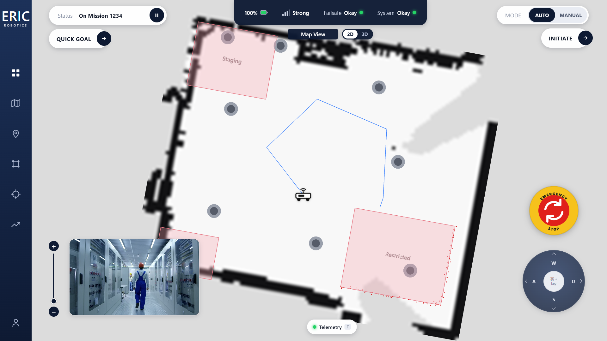
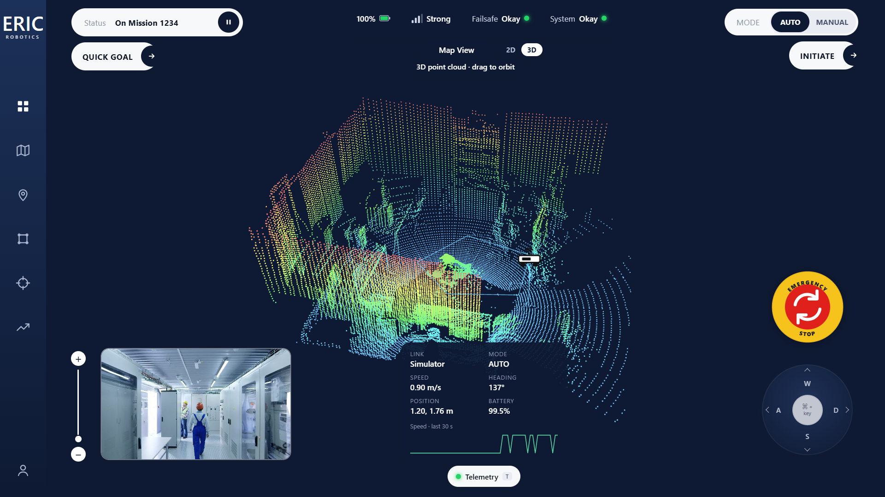
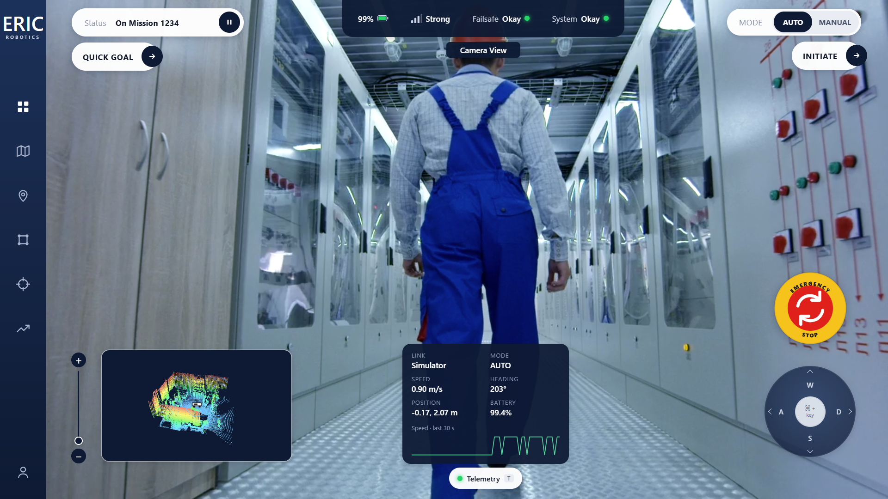
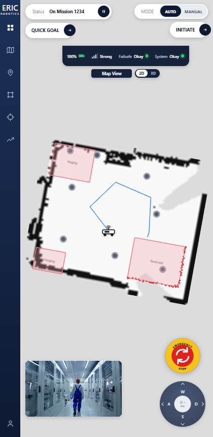

# Insight.IO Dashboard

A self-hosted robot control dashboard, rebuilt from the ERIC Robotics **Insight.IO** design (FSD Assignment #1).

**Author:** Roshan

| 2D map | 3D point cloud |
|---|---|
|  |  |

| Camera view (map in the thumbnail) | Phone layout |
|---|---|
|  |  |

## What it does

- **Map view** – loads a real lidar scan (`.pcd`) with Three.js and shows it two ways:
  - **2D**: a top-down occupancy-grid map (white free space, black walls, grey obstacle markers, pink restricted zones, the robot and its trail). Pan and zoom.
  - **3D**: the raw point cloud, coloured by height, with an orbit camera.
- **Camera view** – plays a video clip with a zoom slider.
- **View swap** – click the thumbnail to swap the camera and the map between full screen and the corner, as in the reference design.
- **Controls** – AUTO / MANUAL mode, pause, Initiate, Quick Goal (click the map to send the robot there), emergency stop and a W/A/S/D pad.
- **Telemetry** – link status, speed, heading, position, battery and a speed graph.
- **ROS integration** – connects to a rosbridge server through roslibjs. Without one it runs on a built-in simulator.

## Quick start

Requirements: **Node.js 18 or newer** and a browser with WebGL.

```bash
npm install        # needs internet once, to fetch the packages
npm run dev        # development server: http://localhost:5173
```

Production build:

```bash
npm run build
npm run preview    # serves the build: http://localhost:4173
```

The app is served over HTTP, so open it through one of these servers. Opening `dist/index.html` straight from the file system will not work.

### Runs offline

After `npm install`, nothing is loaded from the internet. The video, the point cloud, the fonts and all libraries ship with the project. I checked this by loading the production build with every non-localhost request blocked: 0 external requests, 0 console errors.

## Controls

| Input | Action |
|---|---|
| Click the thumbnail | Swap camera and map |
| `2D` / `3D` buttons or `P` | Switch the map between 2D and 3D |
| `W` `A` `S` `D` | Drive (MANUAL mode) |
| `Space` | Pause / resume the mission |
| `E` | Emergency stop on / off |
| `M` | Toggle AUTO / MANUAL |
| `V` | Swap camera and map |
| `T` | Show / hide telemetry |
| Quick Goal, then click the map | Send the robot to that point (AUTO) |

## ROS mode

ROS mode is opt-in. Add `?ros` to the URL (`ws://localhost:9090`) or pass your own address: `?ros=ws://my-robot:9090`. You can also set `VITE_ROSBRIDGE_URL` at build time.

| Direction | Topic | Type |
|---|---|---|
| in | `/odom` | `nav_msgs/msg/Odometry` |
| in | `/battery_state` | `sensor_msgs/msg/BatteryState` |
| out | `/cmd_vel` | `geometry_msgs/msg/Twist` (manual driving) |
| out | `/goal_pose` | `geometry_msgs/msg/PoseStamped` (Quick Goal) |
| out | `/insight/command` | `std_msgs/msg/String` (`pause`, `resume`, `estop`, `release`, `auto`, `manual`, `initiate`) |

Topic names are defined in `src/lib/robot/rosLink.js`.

**Try it without a robot.** A small mock rosbridge server simulates the robot:

```bash
npm run mock:ros                       # terminal 1: ws://localhost:9090
npm run dev                            # terminal 2
# open http://localhost:5173/?ros
```

The telemetry panel then shows **ROS live**. With a real robot, run `rosbridge_suite` and point the dashboard at it; the map and `/insight/command` handling on the robot side are up to your setup.

## Project structure

```
src/
  App.jsx                 page layout, mission state, keyboard shortcuts
  components/             MapView, CameraView, TopBar, StatusPanel, DPad,
                          EmergencyStop, ZoomSlider, Telemetry, Toasts, ...
  hooks/useRobot.js       one interface over the simulator or a ROS robot
  hooks/useToasts.js      short event messages
  lib/mapConfig.js        map settings: zones, start point, route, clip area
  lib/occupancyGrid.js    point cloud -> occupancy-grid image
  lib/robot/simulator.js  robot kinematics (shared with the mock server)
  lib/robot/rosLink.js    roslibjs adapter
scripts/
  prepare-pcd.mjs         crop and colour the raw scan into public/media/map.pcd
  mock-rosbridge.mjs      mock rosbridge server
public/media/             camera.mp4, map.pcd
data/room_scan1.pcd       original scan
docs/screenshots/         images used in this README
```

## Design and architecture decisions

- **React + Vite.** Small, fast to start, and the build is plain static files.
- **Three.js for the map.** `PCDLoader` reads the `.pcd` directly. Both the 2D and 3D views come from the same file.
- **Occupancy grid, not raw points, for 2D.** A lidar floor is only sparse rings, so the 2D view casts a ray from the sensor to every return (free space along the ray, an obstacle where it ends). That gives the solid map style of the reference. Furniture shows as small markers rather than filled blobs.
- **Sized for 1920 px.** The reference is drawn for a 1920 px screen, so every size is in `rem` and the root font size follows the viewport width. Proportions stay the same on any desktop size, and a few rules adapt it for phones.
- **One data interface.** `useRobot` hides whether the pose comes from the browser simulator or from ROS, so the UI components never know the difference.
- **Shared simulator.** The same simulator file runs in the browser and in the mock server, so both behave identically.
- **Single map config.** Zones, route and the visible area live in `src/lib/mapConfig.js`, so a different scan can be dropped in by editing one file.

## Using a different point cloud

Replace `data/room_scan1.pcd` (or pass paths to the script), then:

```bash
npm run prepare:pcd
```

Adjust `ROOM_CLIP`, `ZONES`, `START` and `WAYPOINTS` in `src/lib/mapConfig.js` to match the new scan. The scan must be a `.pcd` with `x y z` fields; the sensor position is set by `SENSOR`.

## Known limitations

- The map is a small furnished office scan, not a factory floor, so its shapes differ from the reference GIF. The pink zones and obstacle markers are placed by hand.
- ROS mode has only been tested against the included mock server, not a real robot.
- The "3D" view is an orbit view of the point cloud, not a full 3D scene with models.
- On phone-width screens the zoom slider and the telemetry panel are hidden.
- The browser sends commands but does not stream the robot's own camera: the camera view plays a video file.

## Credits

- Point cloud: `room_scan1.pcd` from the [PCL sample data](https://github.com/PointCloudLibrary/data) repository.
- Camera clip: free stock video from [Mixkit](https://mixkit.co/).
- Libraries: React, Vite, Three.js, roslibjs.
